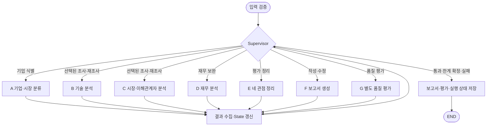

# Subject

본 프로젝트는 Physical AI 기업의 로봇 기술을 선정하여 **기술 성숙도·시장·이해관계자·도메인 적용** 관점에서 근거 기반으로 평가하는 **Supervisor 패턴**의 Multi-Agent Orchestration 프로젝트입니다. 기업별 공개 자료를 조사하고, 부족한 근거를 재조사하며, 별도 품질 평가를 거쳐 중립적인 보고서를 생성합니다.

작업 브랜치는 `Multi-Agent-Orchestration`입니다. 실행 진입점은 루트 `app.py`, 로컬 CLI와 Python 함수입니다.

## Overview

- **Objective:** 하나의 기업·기술을 복수 관점에서 평가하고, 출처·조건·한계를 확인할 수 있는 보고서를 작성합니다.
- **Pattern:** Supervisor — 조사 역할이 정해진 기존 에이전트 중에서 현재 부족한 관점을 담당하는 에이전트를 선택하고 재호출하기에 적합합니다.
- **동적 처리:** 고정된 순서로 모든 단계를 반복하지 않습니다. 시장 근거가 부족하면 C만 재조사하고, 인용·표현 문제는 F만 수정한 뒤 G가 다시 평가합니다. 기업 분류가 미확정이면 B/C/D 조사를 생략하고 제한 보고를 작성합니다.
- **평가 원칙:** 과제 경로에서는 기술 우열·투자·구매를 추천하지 않습니다. 확인되지 않은 사실은 `MissingFact`, 검증하지 못한 품질 기준은 `unknown`으로 남깁니다.

## Selected Technologies

- **평가 대상:** 사용자가 지정한 Physical AI 기업의 로봇 제품·기술. 현재 실행 예시는 로브로스이며, 기업 마스터와 공개 근거로 기업·제품 형태를 먼저 확인합니다.
- **선정 이유:** 제품 사양·시험 조건·현장 적용·고객 요구·사업 지속성을 서로 다른 근거로 검토할 수 있는 분야이기 때문입니다.
- **평가 범위:** 기술 성숙도, 시장 수요·경쟁, 고객·운영자·규제기관 등 이해관계자, 실제 도메인의 적용 조건과 제약입니다. 재무자료는 사업 지속성을 보완합니다.

## Features

- **자료 적재:** PDF·Markdown·JSON·JSONL 로컬 자료의 텍스트 추출, 청킹, FAISS 색인과 SQLite 메타데이터 저장. PDF는 텍스트 추출 방식이며 OCR은 포함하지 않습니다.
- **근거 검색:** 기본 BM25 또는 사전 구축 FAISS 색인을 연결하고 기업·기준일·출처 등급을 확인합니다. 실행 시 기업 마스터와 출처 manifest가 필요합니다.
- **관점별 평가:** B/C/D의 조사 결과를 E가 네 관점으로 정리하고 F가 인용된 보고서로 작성합니다.
- **동적 재작업:** 근거 부족, 평가 실패, 일시적 호출 오류를 구분하고 담당 조사·보고서 수정·오류 재시도로 분기합니다.
- **확증 편향 방지 전략:** 독립 출처와 반대·불확실 근거를 확인하며 출처 분산을 검사합니다. 서로 다른 도메인이라는 이유만으로 독립성을 확정하지 않습니다.
- **보고서 품질 평가:** 별도 G가 근거 연결성·중립성·편향·네 관점 커버리지를 코드 검사와 의미 Judge로 평가합니다. PDF 생성 시 최대 10쪽도 검사합니다.
- **재개·관측성:** SQLite 체크포인트로 실행을 재개하고 로컬 이벤트와 선택적 LangSmith trace에 노드 선택·사유·시도·시간을 기록합니다.
- **산출물:** Markdown·PDF·구조화 JSON과 실행 상태 `passed`/`incomplete`/`failed`를 저장합니다.

## Tech Stack

- **Framework:** Python 3.11+, LangGraph, Pydantic v2.
- **LLM/Generator:** LangChain OpenAI 구조화 출력. GPT 모델명은 `--model`로 지정하며 현재 고정된 모델 버전은 없습니다.
- **LLM/Judge:** `--judge-model`로 별도 GPT 모델을 지정합니다. 생략하면 Generator 모델을 사용하며, 모두 미설정이면 의미 평가는 `unknown`입니다.
- **Retrieval:** BM25 기본, FAISS + SQLite 메타데이터 선택. **Hit Rate@K·MRR은 미측정**이며 검증용 정답 문서 집합이 필요합니다.
- **Embedding:** 오픈소스 `Qwen/Qwen3-Embedding-0.6B`, 1024차원. FAISS 경로에서 로컬 실행합니다.
- **Persistence / Tracing:** SQLite 체크포인터, 로컬 JSONL 이벤트, 선택적 LangSmith 전송.
- **Report:** ReportLab PDF, Markdown, JSON.

## Agents

- **Supervisor:** State·오류·근거 충분성·품질 결과를 확인하고 다음 작업과 종료를 결정합니다. 모델의 제안도 코드가 선행 조건과 예산으로 검증합니다.
- **Agent A — 기업·시장 분류:** 기업 동일성, Physical AI 형태와 분석 범위를 확인하고 분류 검토 여부를 반환합니다.
- **Agent B — 기술 분석:** 제품·논문·특허·시험 근거로 기술 성숙도와 도메인 적용 조건을 조사합니다.
- **Agent C — 시장·이해관계자 분석:** 시장 수요·경쟁, 고객·운영자 요구, 독립 출처와 반대 근거를 조사합니다.
- **Agent D — 재무 분석:** DART·FSC·KIND 자료의 출처와 기준일을 확인해 사업 지속성을 보완합니다. API 미사용·자료 미확보는 한계로 남깁니다.
- **Agent E — 평가 정리:** 조사 근거와 결측·오류를 네 관점의 중립 평가로 정리합니다.
- **Agent F — 보고서 생성:** `SUMMARY`부터 `REFERENCE`까지 근거 ID와 원문 URL이 연결된 보고서를 작성·수정합니다.
- **Agent G — 보고서 품질 평가:** 완성된 보고서를 별도로 평가하고 실패 기준의 담당과 재작업 질문을 반환합니다.

작업자는 `TaskRequest`와 State 스냅샷을 받고 결과를 반환합니다. 서로 직접 호출하지 않으며, 모든 작업 선택은 Supervisor를 거칩니다. 기존 `analyze` 경로의 E 투자 판단과 과제 경로의 E 평가 정리는 별도 계약입니다.

기존 모듈 기여자는 다음과 같습니다. 실제 협업 작업 범위는 [AGENTS.md](AGENTS.md)에 따라 개별 작업에서 할당합니다.

| 이름 | 기존 담당 영역 |
|---|---|
| 김지훈 | LangGraph, VectorDB |
| 박시현 | 투자보고서 생성 Agent |
| 이병길 | 재무 정보 수집 Agent |
| 이수빈 | 설계 |
| 최병준 | Tech Agent, Decision Agent |
| 최유정 | 접수/분류 Agent, 시장/경쟁 Agent |

## State Schema

- **제어 vs 페이로드 분리:** 작업 선택·요청·상태·예산은 제어 필드, 기업·관점별 분석·근거·보고서·품질 결과는 페이로드입니다. 오류는 `error_count`, `last_error`, `task_errors`, `retry_counts`로 관리합니다.
- **관측성 위치:** 결정 이력은 로컬 `events.jsonl`과 LangSmith에 기록합니다. State에는 현재 결정·작업 결과·복구 정보만 보존합니다. 원문·질문·전체 State·모델 prompt는 LangSmith 전송에서 제외합니다.
- **지속성 비용:** 원문 문서는 외부 자료 디렉터리에 두고 State에는 근거 인용·요약·참조를 저장합니다. 과거 작업 결과는 호출 상한 내에서 멱등 재개를 위해 보존합니다.
- **상관:** `run_id`/`thread_id`/`trace_id`를 같은 UUID로 연결합니다. 안정된 task ID와 attempt로 결과·오류·trace를 연결하고, 분석·보고서 revision으로 오래된 결과를 구분합니다. 오류·작업 시작·완료 시각은 timezone-aware UTC입니다.
- **재개/복구:** SQLite에 체크포인트를 저장하고 동일 UUID·입력·자료·설정 지문으로 재개합니다. 완료 결과를 재사용하지만 중단 당시 완료 여부를 알 수 없는 외부 호출은 다시 실행될 수 있습니다.
- **동시 처리:** 선택된 독립 조사 작업을 병렬 실행합니다. 작업자는 `task_results`만 쓰고 reducer가 task/attempt 키로 병합하며 동일 키의 다른 결과는 거부합니다. 수집 노드가 활성 근거·분석·오류를 합친 뒤 Supervisor로 돌아갑니다.
- **종료 보장:** 연구별 최대 3회, F/G 각각 최대 3회, Supervisor 최대 20회, 전체 최대 60회, 오류 최대 6회가 기본 상한입니다. 무진행 감지와 graph recursion limit도 적용합니다. 충분성 미충족·미해결 오류·품질 `unknown`은 `passed`로 처리하지 않습니다.

실제 모델·State·reducer·재개 계약은 [인터페이스 계약](docs/contracts.md), 패턴과 단계별 설계 근거는 [구현 설계 20장](docs/implementation-design.md#20-multi-agent-orchestration-단계별-설계)을 따릅니다.

## Architecture



화살표는 허용 경로이며 모든 에이전트를 매번 호출한다는 뜻은 아닙니다. 초기 B/C는 함께 조사할 수 있고, 시장 자료 부족은 C 재조사, 문장·인용 문제는 F 수정 후 G 재평가로 돌아갑니다. 분석 결과가 바뀌면 이전 E/F/G 결과를 무효화합니다.

## Directory Structure

현재 저장소의 실제 구조를 사용합니다. 자료·색인·보고서는 로컬 파일이며 커밋하지 않습니다.

```text
├── src/skala_rag/
│   ├── agents/                    # Supervisor, A~F 모듈, 별도 품질 평가 G
│   ├── graph/                     # 투자/Supervisor 그래프, 공유 State와 reducer
│   ├── models/                    # 기업·근거·요청·결과·오류·품질 모델
│   ├── ingestion/                 # 로컬 문서 로딩·청킹·임베딩·색인
│   ├── retrieval/                 # FAISS 검색과 SQLite 메타데이터
│   ├── runtime.py                 # 기존 조사 모듈과 모델의 연결
│   ├── tracing.py                 # 민감정보를 제외한 로컬/LangSmith 이벤트
│   ├── pdf_report.py              # PDF 보고서 렌더링
│   └── cli.py                     # orchestrate/analyze/report/index 진입점
├── scripts/                       # 기존 예시·검증·보고서 스크립트
├── tests/                         # 단위·통합·재개 테스트
├── docs/                          # 구현 설계와 인터페이스 계약
├── app.py                         # 직접 실행 진입점, 기본 Supervisor 경로
├── storage/                       # 실행 시 사용하는 로컬 저장 경로
│   ├── indexes/                   # 생성한 FAISS 색인
│   └── reports/<run_id>/           # 보고서·JSON·이벤트·SQLite 체크포인트
├── pyproject.toml
├── uv.lock
├── AGENTS.md
└── README.md
```

문서 풀은 `--research-root`로 지정합니다. 기업 마스터·출처 manifest·원문 자료를 가진 외부 자료조사 디렉터리를 사용하며 필요할 때 `storage/raw/`에 둘 수 있습니다. 프롬프트는 각 모듈에 있으므로 별도 `prompts/` 디렉터리는 만들지 않습니다.

## Usage

```bash
# 기본 환경 준비
uv sync --group dev
source .venv/bin/activate

# 실행 옵션 안내
python app.py

# 로컬 자료로 Supervisor 실행: API·의미 평가 모델 없이 동작 확인
python app.py \
  --query "로브로스의 기술 성숙도·시장·이해관계자·도메인 적용 평가" \
  --company 로브로스 --as-of-date 2026-09-30 \
  --research-root ../자료조사 --no-pdf

# GPT 모델과 LangSmith를 연결할 경우
uv sync --extra llm --group dev
# OPENAI_API_KEY, LANGSMITH_API_KEY를 환경변수로 설정합니다.
# GENERATION_MODEL, JUDGE_MODEL에는 사용 가능한 GPT 모델명을 설정합니다.
python app.py \
  --query "로브로스의 네 관점 중립 평가" \
  --company 로브로스 --as-of-date 2026-09-30 \
  --research-root ../자료조사 \
  --model "$GENERATION_MODEL" --judge-model "$JUDGE_MODEL" \
  --langsmith --langsmith-project skala-supervisor

# 출력 UUID로 재개: 자료·모델·검색·PDF·예산 옵션은 원래 실행과 동일하게 전달
python app.py --resume <run-UUID> \
  --research-root ../자료조사 \
  --model "$GENERATION_MODEL" --judge-model "$JUDGE_MODEL" \
  --langsmith --langsmith-project skala-supervisor

# 선택: 원문 자료를 FAISS 색인으로 구축
python app.py index build --source ../자료조사 --output storage/indexes/demo-v1
# orchestrate에 --retriever faiss --index storage/indexes/demo-v1을 추가해 사용

# 전체 검사: 재무 모듈 내부 테스트도 포함
uv run pytest -q
```

- `python app.py`는 실행 옵션을 보여 줍니다. 저장소의 `.venv`가 있으면 해당 Python으로 실행하므로 시스템 Python과 의존성이 섞이지 않습니다. `--query` 등 옵션을 전달하면 기본 `orchestrate` 경로를 실행하며, `analyze`/`report`/`index` 하위 명령도 그대로 사용할 수 있습니다. `uv run python app.py ...`로도 실행할 수 있습니다.
- 기본 검색은 BM25입니다. 의미 모델 없이 실행한 결과는 내용 검증이 완료되지 않아 `incomplete`일 수 있습니다. `--financial-api`는 설정한 재무 API를 활성화합니다.
- PDF를 만들려면 한글 폰트가 필요하며 `SKALA_PDF_FONT`로 경로를 지정할 수 있습니다. `--no-pdf`는 PDF 생성과 쪽수 검사를 생략합니다.
- 결과는 `storage/reports/<run_id>/`의 `input.json`, `checkpoints.sqlite3`, `events.jsonl`, `result.json`, `report.md`, 선택적 `report.pdf`에 저장합니다. 보고서가 있더라도 최종 상태는 `result.json`으로 확인합니다.
- 종료 코드 0은 품질 통과·전송 오류 없음, 2는 미완료/실패/전송 오류, 1은 설정 오류입니다. 분석 상태와 LangSmith 전송 상태는 별도로 기록합니다.
- 실제 원격 모델 품질·LangSmith 대시보드 표시·제출용 trace 캡처는 별도 실행 검증 대상입니다. 로컬 테스트는 제어 분기·오류 복구·품질 수정·영속 재개를 검증합니다.
- 기존 투자 분석은 `uv run skala-rag analyze --help`를 확인합니다. 개발·협업 규칙은 [AGENTS.md](AGENTS.md)를 따릅니다.
