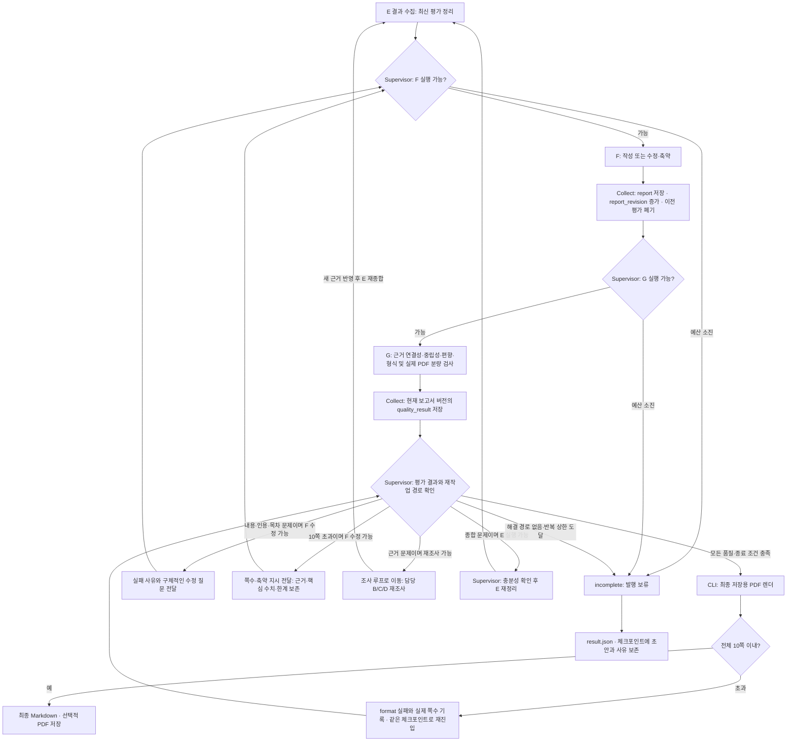
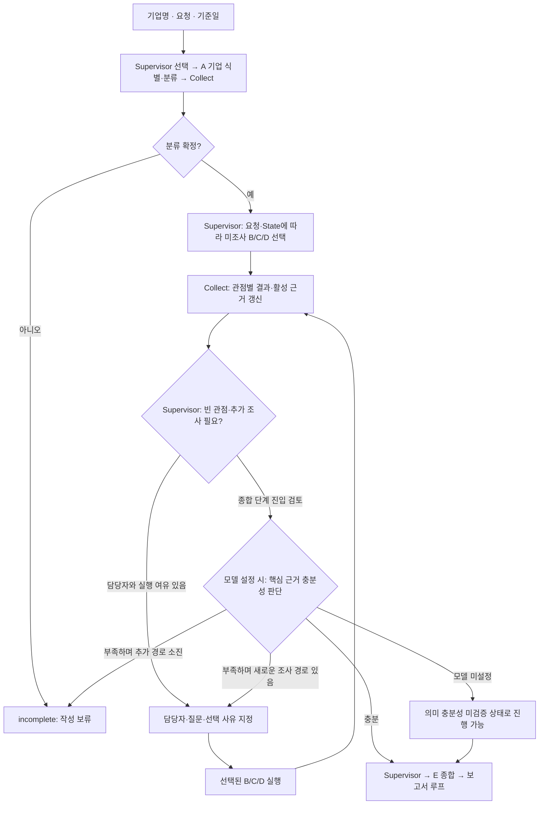
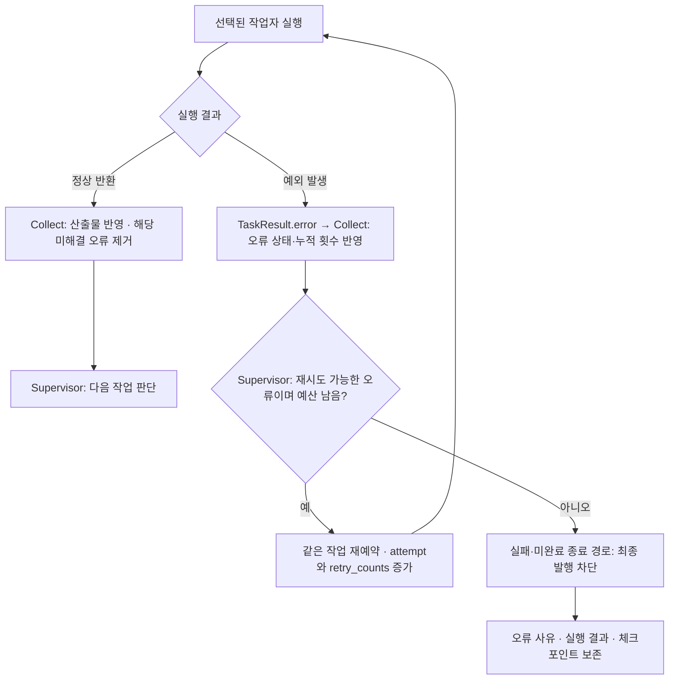

# Subject

본 프로젝트는 Physical AI 기업의 로봇 기술을 선정하여 **기술 성숙도·시장·이해관계자·도메인 적용** 관점에서 근거 기반으로 평가하는 **Supervisor 패턴**의 Multi-Agent Orchestration 프로젝트입니다. 기업별 공개 자료를 조사하고, 부족한 근거를 재조사하며, 별도 품질 평가를 거쳐 중립적인 보고서를 생성합니다.

현재 기준은 [Multi-Agent Orchestration 과제](https://app.notion.com/p/3f8b7788ac2a80f48845e9e9fc755e89)입니다. 하위 [AI 스타트업 투자 평가](https://app.notion.com/p/48db7788ac2a835b84cf810d2c6b6d72)는 이전 과제로, 기업 평가 주제와 기존 보고서 구성을 계승합니다. 이전의 순차·병렬 실행과 5쪽 제한을 이번 기준으로 적용하지 않습니다.

- 기존 14개 목차(SUMMARY, INVESTMENT SNAPSHOT, BUSINESS IDEA, PRODUCT & TECHNOLOGY, MARKET, COMPETITION & MOAT, TRACTION, TEAM, FINANCIALS, VALUATION, KEY RISKS, INVESTMENT DECISION, LIMITATIONS, REFERENCE)를 유지합니다. 판단 장은 근거·반대 논거·추가 실사 조건을 서술하며 근거 없는 점수·추천을 생성하지 않습니다.
- SUMMARY는 전체 핵심 요약으로 반 페이지 이내, PDF 전체는 REFERENCE 포함 최대 10쪽입니다. 정확히 10쪽을 채우는 목표는 아닙니다.
- REFERENCE는 실제 본문/SUMMARY에 사용된 자료만 담습니다. 서지 정보가 없는 경우 미확인으로 표시하며 저자·자료 제목을 만들어 넣지 않습니다.
- 노션 표에 남은 관점 커버리지는 강의 중 제외한다는 구두 정정을 따릅니다. 필수 품질 항목은 근거성·중립성·편향 통제이며, 목차와 분량은 별도 형식 검사입니다. 내부 네 관점은 팀의 조사 구조입니다.

작업 브랜치는 `Multi-Agent-Orchestration`입니다. 실행 진입점은 루트 `app.py`, 로컬 CLI와 Python 함수입니다.

## Overview

- **Objective:** 하나의 기업·기술을 복수 관점에서 평가하고, 출처·조건·한계를 확인할 수 있는 보고서를 작성합니다.
- **Pattern:** Supervisor — 조사 역할이 정해진 기존 에이전트 중에서 현재 부족한 관점을 담당하는 에이전트를 선택하고 재호출하기에 적합합니다.
- **동적 처리:** 고정된 순서로 모든 단계를 반복하지 않습니다. 시장 근거가 부족하면 C만 재조사하고, 인용·표현 문제는 F만 수정한 뒤 G가 다시 평가합니다. 기업 분류가 미확정이면 B/C/D 조사와 최종 보고서 발행을 보류합니다.
- **평가 원칙:** 과제 경로에서는 기술 우열·투자·구매를 추천하지 않습니다. 확인되지 않은 사실은 `MissingFact`, 검증하지 못한 품질 기준은 `unknown`으로 남깁니다.

## Selected Technologies

- **평가 대상:** 사용자가 지정한 Physical AI 기업의 로봇 제품·기술. 현재 실행 예시는 로브로스이며, 기업 마스터와 공개 근거로 기업·제품 형태를 먼저 확인합니다.
- **선정 이유:** 제품 사양·시험 조건·현장 적용·고객 요구·사업 지속성을 서로 다른 근거로 검토할 수 있는 분야이기 때문입니다.
- **평가 범위:** 기술 성숙도, 시장 수요·경쟁, 고객·운영자·규제기관 등 이해관계자, 실제 도메인의 적용 조건과 제약입니다. 재무자료는 사업 지속성을 보완합니다.

## Features

- **자료 적재:** PDF·Markdown·JSON·JSONL 로컬 자료의 텍스트 추출, 청킹, FAISS 색인과 SQLite 메타데이터 저장. PDF는 텍스트 추출 방식이며 OCR은 포함하지 않습니다.
- **근거 검색:** 기존 FAISS 색인이 있으면 우선 사용하고 없으면 BM25 검색을 연결하고 기업·기준일·출처 등급을 확인합니다. 실행 시 기업 마스터와 출처 manifest가 필요합니다.
- **관점별 평가:** B/C/D의 조사 결과를 E가 네 관점으로 정리하고 F가 인용된 보고서로 작성합니다.
- **동적 재작업:** 근거 부족, 평가 실패, 일시적 호출 오류를 구분하고 담당 조사·보고서 수정·오류 재시도로 분기합니다.
- **확증 편향 방지 전략:** 독립 출처와 반대·불확실 근거를 확인하며 출처 분산을 검사합니다. 서로 다른 도메인이라는 이유만으로 독립성을 확정하지 않습니다.
- **보고서 품질 평가:** 별도 G가 근거 연결성·중립성·편향을 코드 검사와 의미 Judge로 평가하고 기존 목차·SUMMARY 분량을 별도 검사합니다. PDF 생성 시 최대 10쪽도 검사합니다.
- **재개·관측성:** SQLite 체크포인트로 실행을 재개하고 로컬 이벤트와 선택적 LangSmith trace에 노드 선택·사유·시도·시간을 기록합니다.
- **산출물:** Markdown·PDF·구조화 JSON과 실행 상태 `passed`/`incomplete`/`failed`를 저장합니다.

## Tech Stack

- **Framework:** Python 3.11+, LangGraph, Pydantic v2.
- **LLM/Generator:** LangChain OpenAI 구조화 출력. GPT 모델명은 `--model`로 지정하며 현재 고정된 모델 버전은 없습니다.
- **LLM/Judge:** `--judge-model`로 별도 GPT 모델을 지정합니다. 생략하면 Generator 모델을 사용하며, 모두 미설정이면 의미 평가는 `unknown`입니다.
- **Retrieval:** BM25 기본, FAISS + SQLite 메타데이터 선택. **Hit Rate@K·MRR은 미측정**이며 검증용 정답 문서 집합이 필요합니다.
- **Embedding:** 오픈소스 `Qwen/Qwen3-Embedding-0.6B`, 1024차원. FAISS 경로에서 로컬 실행합니다.
- **Persistence / Tracing:** SQLite 체크포인터, 로컬 JSONL 이벤트, 선택적 LangSmith 전송.
- **Report:** ReportLab PDF, Markdown, JSON.

## Agents

- **Supervisor:** State·오류·근거 충분성·품질 결과를 확인하고 다음 작업과 종료를 결정합니다. 모델의 제안도 코드가 선행 조건과 예산으로 검증합니다.
- **Agent A — 기업·시장 분류:** 기업 동일성, Physical AI 형태와 분석 범위를 확인하고 분류 검토 여부를 반환합니다.
- **Agent B — 기술 분석:** 제품·논문·특허·시험 근거로 기술 성숙도와 도메인 적용 조건을 조사합니다.
- **Agent C — 시장·이해관계자 분석:** 시장 수요·경쟁, 고객·운영자 요구, 독립 출처와 반대 근거를 조사합니다.
- **Agent D — 재무 분석:** DART·FSC·KIND 자료의 출처와 기준일을 확인해 사업 지속성을 보완합니다. API 미사용·자료 미확보는 한계로 남깁니다.
- **Agent E — 평가 정리:** 조사 근거와 결측·오류를 네 관점의 중립 평가로 정리합니다.
- **Agent F — 보고서 생성:** `SUMMARY`부터 `REFERENCE`까지 근거 ID와 원문 URL이 연결된 보고서를 작성·수정합니다.
- **Agent G — 보고서 품질 평가:** 완성된 보고서를 별도로 평가하고 실패 기준의 담당과 재작업 질문을 반환합니다.

작업자는 `TaskRequest`와 State 스냅샷을 받고 결과를 반환합니다. 서로 직접 호출하지 않으며, 모든 작업 선택은 Supervisor를 거칩니다. 기존 `analyze` 경로의 E 투자 판단과 과제 경로의 E 평가 정리는 별도 계약입니다.

## Contributors

기존 모듈 기여자는 다음과 같습니다. 실제 협업 작업 범위는 [AGENTS.md](AGENTS.md)에 따라 개별 작업에서 할당합니다.

| 이름 | 기존 담당 영역 |
|---|---|
| 김지훈 | LangGraph, VectorDB |
| 박시현 | 투자보고서 생성 Agent |
| 이병길 | 재무 정보 수집 Agent |
| 이수빈 | 설계 |
| 최병준 | Tech Agent, Decision Agent |
| 최유정 | 접수/분류 Agent, 시장/경쟁 Agent |

## State Schema

- **제어 vs 페이로드 분리:** 작업 선택·요청·상태·예산은 제어 필드, 기업·관점별 분석·근거·보고서·품질 결과는 페이로드입니다. 오류는 `error_count`, `last_error`, `task_errors`, `retry_counts`로 관리합니다.
- **관측성 위치:** 결정 이력은 로컬 `events.jsonl`과 LangSmith에 기록합니다. State에는 현재 결정·작업 결과·복구 정보만 보존합니다. 원문·질문·전체 State·모델 prompt는 LangSmith 전송에서 제외합니다.
- **지속성 비용:** 원문 문서는 외부 자료 디렉터리에 두고 State에는 근거 인용·요약·참조를 저장합니다. 과거 작업 결과는 호출 상한 내에서 멱등 재개를 위해 보존합니다.
- **상관:** `run_id`/`thread_id`/`trace_id`를 같은 UUID로 연결합니다. 안정된 task ID와 attempt로 결과·오류·trace를 연결하고, 분석·보고서 revision으로 오래된 결과를 구분합니다. 오류·작업 시작·완료 시각은 timezone-aware UTC입니다.
- **재개/복구:** SQLite에 체크포인트를 저장하고 동일 UUID·입력·자료·설정 지문으로 재개합니다. 완료 결과를 재사용하지만 중단 당시 완료 여부를 알 수 없는 외부 호출은 다시 실행될 수 있습니다.
- **동시 처리:** 선택된 독립 조사 작업을 병렬 실행합니다. 작업자는 `task_results`만 쓰고 reducer가 task/attempt 키로 병합하며 동일 키의 다른 결과는 거부합니다. 수집 노드가 활성 근거·분석·오류를 합친 뒤 Supervisor로 돌아갑니다.
- **종료 보장:** 연구별 최대 2회, F/G 각각 최대 2회, Supervisor 최대 12회, 전체 최대 40회, 오류 최대 4회가 기본 상한입니다. 무진행 감지와 graph recursion limit도 적용합니다. 충분성 미충족·미해결 오류·품질 `unknown`은 `passed`로 처리하지 않습니다.

### 강의 State 예시의 적용 근거

이 과제는 **Supervisor**를 선택했습니다. State는 평가 실행별 공유 작업 상태이며, 에이전트마다 독립 State를 추가하지 않습니다. 아래 각주는 설계 이유와 제출 시 확인할 증거를 연결합니다. 예시의 필드명은 그대로 복사하지 않고 기업 평가 목적에 맞춰 대응했습니다.

| 강의 예시 / 항목 | 실제 필드 | 설계 이유 |
|---|---|---|
| `selected_tech`, `target_domain` | `company_profile`, `market_category`, `as_of_date` | 기술 목록보다 평가 기업·유형·시장·기준일이 조사 범위를 결정함[^state-input] |
| `perspectives`, `sources` | `perspectives`, `evidence`, `active_evidence_ids` | 주장과 근거 ID를 연결하고 최신 연구 결과만 활성화함[^state-payload] |
| `synthesis`, `report`, `eval_result` | `evaluation_summary`, `report`, `quality_result` | 종합·초안·품질판정을 분리하고 이전 버전의 통과 결과 재사용을 막음[^state-version] |
| 제어 / 작업 결과 분리 | `next_action`, `pending_tasks`, `task_results`, `task_status` | 다음 대상·질문을 결정하는 제어 정보와 작업 산출물을 구분함[^state-route] |
| 관측성 / 상관 | `trace_id`, `run_id`, `thread_id` | 전체 결정 이력은 외부 로그에 두고 같은 실행을 연결함[^state-trace] |
| 지속성 비용 | 최신 산출물 + 호출 상한 내 `task_results` | 원문 파일·인덱스는 외부 보관. 과거 작업 payload 중복은 남아 있어 저장량 최적화 여지가 있음[^state-size] |
| 재개 / 복구 | `collected_tasks`, `task_errors`, `retry_counts`, 버전·입력 지문 | 이미 반영한 결과 중복 반영을 막고 일시적 오류를 재시도함[^state-recovery] |
| 동시 처리 | `task_results`의 `merge_task_results` reducer | B/C 병렬 결과를 작업·시도별 키로 병합하고 충돌을 거부함[^state-concurrency] |
| 종료 보장 | `attempts`, `limits`, `step_count`, `supervisor_count`, `stagnant_agents` | 성공 여부와 반복 예산을 분리하고 무진행·상한에서 종료함[^state-end] |

[^state-input]: A의 분류는 보고서 `INVESTMENT SNAPSHOT`에도 표시합니다. `report.classification`은 State의 기업/시장 분류에서 구성하며 G가 일치를 검사합니다.
[^state-payload]: 근거 본문 일부는 `Evidence`에 포함됩니다. State에 원문 파일을 넣지 않는다는 것이 모든 텍스트를 ID만으로 저장한다는 뜻은 아닙니다. `collect`는 최신 성공 연구 결과에서 활성 근거를 재구성합니다.
[^state-version]: `analysis_revision` 변경은 E/F/G 결과를, `report_revision` 변경은 G 결과를 무효화합니다. 차트·분류표·참고문헌도 최대 10쪽에 포함되며, 초과 시 F 축약 후 G 재평가를 합니다.
[^state-route]: **제출된 실행 트레이스와 코드로 확인합니다. Supervisor는 라우팅과 재작업 횟수·사유를 확인하는 것이 핵심입니다.** `supervisor` 이벤트의 `action`, `targets`, `reason`과 작업 이벤트의 `task_id`, `attempt`를 연결합니다. 최초 호출과 후속 재조사/재작성, 오류 재시도를 구분합니다. `supervisor_count`는 조정자 진입 횟수이고 `step_count`는 전체 실행 예산용이므로 재작업 수와 같지 않습니다.
[^state-trace]: 로컬 `events.jsonl` 및 선택적 LangSmith의 run/trace ID를 최종 `result.json`과 연결합니다. State의 현재 `next_action.reason`은 다음 실행에 필요한 정보이며 전체 결정 로그는 아닙니다. 테스트 통과와 실제 제출용 LangSmith 캡처 확보는 별도입니다. **현재 원격 실제 실행·제출용 캡처는 미완료입니다.**
[^state-size]: 호출 횟수는 제한하지만 직렬화된 State의 바이트 상한까지 보장하지 않습니다. 과거 상세 payload를 외부 저장하고 참조만 남기는 최적화는 아직 적용하지 않았습니다.
[^state-recovery]: `attempts`는 예약된 전체 시도, `retry_counts`는 오류 재시도 예약을 셉니다. 실제 완료 횟수는 task 결과/트레이스와 대조합니다. 체크포인트 재개 시 중단 당시 완료 여부를 모르는 외부 호출의 정확히 한 번 실행은 보장하지 않습니다.
[^state-concurrency]: **Orchestrator-Workers를 선택했다면 구조화된 plan과 그 결과에 따라 생성된 dynamic fan-out을 코드·트레이스로 입증해야 합니다.** 이 프로젝트는 Supervisor이므로 해당 패턴의 필수 항목은 비적용입니다. B/C 병렬 실행과 `Send` 사용만으로 Orchestrator의 dynamic fan-out 충족을 주장하지 않습니다.
[^state-end]: 기본 연구 에이전트별 2회, F/G 각 2회, Supervisor 12회, 전체 40회, 오류 4회입니다. 단계 수를 채웠다고 성공하지 않으며, 실제 PDF 최종 검사에서 재진입해도 예산을 초기화하지 않습니다.

### 제출 트레이스와 코드의 대조

| 확인할 장면 | 트레이스 증거 | 코드 / 검사 |
|---|---|---|
| State 기반 라우팅 | Supervisor의 대상·사유 → 작업 → collect → Supervisor | `agents/supervisor.py`, `graph/supervisor_workflow.py` |
| 문제별 재작업 | 부족 근거는 B/C/D, 작성 문제는 F 선택; 작업 attempt 증가 | `tests/graph/test_supervisor.py`의 재조사·형식 수정 검사 |
| 10쪽 초과 재진입 | `publication`의 rework/실제 쪽수 → F → G; 보고서 revision 증가 | `cli.py`, `test_late_pdf_overflow_returns_to_writer_and_judge_before_publication` |
| 반복 제한 / 성공 구분 | 예산 소진은 incomplete/failed, 품질 통과와 쪽수 충족 후 발행 | 동일 run의 result.json·체크포인트·최종 파일 대조 |

모델 설정 시 초기 조사 대상도 요청·현재 State에 따라 선택합니다. 기업 식별 및 필수 자료 가용성 확인, 오류·예산·버전 가드는 코드가 보장합니다. 실제 실행별 라우팅 수·재작업 수는 해당 제출 트레이스에서 집계하며, 테스트의 호출 횟수를 실제 모델 실행 결과로 대신 쓰지 않습니다.

실제 모델·State·reducer·재개 계약은 [인터페이스 계약](docs/contracts.md), 패턴과 단계별 설계 근거는 [구현 설계 20장](docs/implementation-design.md#20-multi-agent-orchestration-단계별-설계)을 따릅니다.

## Architecture

실제 그래프 연결은 `Supervisor → 선택된 작업자 → collect → Supervisor`입니다. 아래 그림은 한 Supervisor 안의 판단을 단계별로 펼친 설명도이며, 그림의 판단 상자마다 별도 에이전트가 있는 것은 아닙니다. 에이전트가 다른 에이전트를 직접 호출하지 않습니다.

### 1. 보고서 작성·수정·축약 루프



- F의 보고서는 초안입니다. 수정할 때마다 `report_revision`을 증가시키고 G의 이전 판정을 폐기합니다.
- G의 `fail` 또는 담당 작업이 지정된 `unknown`은 재작업 후보입니다. Supervisor가 횟수·오류·무진행 여부를 확인한 뒤 담당자를 선택합니다.
- 근거 자체가 부족하면 F에게 문장만 바꾸게 하지 않고 B/C/D 조사로 돌아갑니다. 연구가 변경되면 종합·보고서·평가를 초기화하고 E부터 다시 진행합니다.
- G 검사와 최종 저장 검사 모두 10쪽 초과 시 축약 경로로 돌아갑니다. 분류표·그래프·REFERENCE도 10쪽에 포함됩니다. 동일한 시도·단계 예산을 사용하며 상한을 초기화하지 않습니다.
- 기본 F/G 각각 최대 2회이며 전체 단계·Supervisor·오류 상한도 적용됩니다. 코드의 필수 실행 오류는 아래 오류 루프에서 처리합니다.

### 2. 조사·근거 보완 루프



모델을 설정한 실행에서는 Supervisor가 요청·수집된 관점에 따라 미조사 B/C/D 중 다음 담당과 병렬 묶음을 선택합니다. 기업 식별과 각 담당의 자료 가용성 확인은 필수이며, 모델 미설정 진단 모드만 B/C 다음 D의 기본 정책을 사용합니다. 재조사에서는 부족한 관점, 요청 질문, 오류, 동일 결과 반복과 시도 예산을 사용합니다. 모델이 없으면 의미적 충분성 검증은 수행되지 않으며, 의미 품질 Judge도 없으면 보고서 품질을 자동 통과시키지 않습니다. 명시적 `research_sufficient=False`는 E/F 진입을 차단합니다.

### 3. 일시적 오류 재시도 루프



timeout·연결 오류·429·5xx는 제한 내 재시도합니다. 인증·계약·프로그래밍 오류는 같은 작업을 무조건 반복하지 않습니다. 자료 부족은 정상 반환된 `insufficient`/`unavailable`일 수 있으므로 실행 예외와 구분하며, 조사 루프에서 판단합니다. 성공 후에도 `last_error` 기록은 남을 수 있고, 현재 해결 여부는 `task_errors`로 확인합니다.

### 코드와 트레이스의 연결

| 보고 싶은 흐름 | 실제 코드 | 트레이스 확인 |
|---|---|---|
| 대상 선택·재작업 | `agents/supervisor.py`, `runtime.py` | supervisor의 action·targets·reason |
| 결과 반영·버전 변경 | `graph/supervisor_workflow.py`, `graph/state.py` | 작업 attempt·collect·analysis_revision |
| 품질평가·형식 실패 | `agents/report_evaluation.py` | G 실행 및 현재 report_revision의 판정 |
| 최종 PDF 초과 재진입 | `cli.py` | publication rework·실제 pages → Supervisor → F → G |


## Directory Structure

현재 저장소의 실제 구조를 사용합니다. 자료·색인·보고서는 로컬 파일이며 커밋하지 않습니다.

```text
├── src/skala_rag/
│   ├── agents/                    # Supervisor, A~F 모듈, 별도 품질 평가 G
│   ├── graph/                     # 투자/Supervisor 그래프, 공유 State와 reducer
│   ├── models/                    # 기업·근거·요청·결과·오류·품질 모델
│   ├── ingestion/                 # 로컬 문서 로딩·청킹·임베딩·색인
│   ├── retrieval/                 # FAISS 검색과 SQLite 메타데이터
│   ├── runtime.py                 # 기존 조사 모듈과 모델의 연결
│   ├── tracing.py                 # 민감정보를 제외한 로컬/LangSmith 이벤트
│   ├── pdf_report.py              # PDF 보고서 렌더링
│   └── cli.py                     # orchestrate/analyze/report/index 진입점
├── scripts/                       # 기존 예시·검증·보고서 스크립트
├── tests/                         # 단위·통합·재개 테스트
├── docs/                          # 구현 설계와 인터페이스 계약
├── app.py                         # 직접 실행 진입점, 기본 Supervisor 경로
├── storage/                       # 실행 시 사용하는 로컬 저장 경로
│   ├── indexes/                   # 생성한 FAISS 색인
│   └── reports/<run_id>/           # 보고서·JSON·이벤트·SQLite 체크포인트
├── pyproject.toml
├── uv.lock
├── AGENTS.md
└── README.md
```

문서 풀은 `--research-root`로 지정합니다. 기업 마스터·출처 manifest·원문 자료를 가진 외부 자료조사 디렉터리를 사용하며 필요할 때 `storage/raw/`에 둘 수 있습니다. 프롬프트는 각 모듈에 있으므로 별도 `prompts/` 디렉터리는 만들지 않습니다.

## Usage

```bash
# 기본 환경 준비
uv sync --group dev
source .venv/bin/activate

# 실행 옵션 안내
python app.py

# 로컬 자료로 Supervisor 실행: API·의미 평가 모델 없이 동작 확인
python app.py \
  --query "로브로스의 기술 성숙도·시장·이해관계자·도메인 적용 평가" \
  --company 로브로스 --as-of-date 2026-09-30 \
  --research-root ../자료조사 --no-pdf

# GPT 모델과 LangSmith를 연결할 경우
uv sync --extra llm --group dev
# OPENAI_API_KEY, LANGSMITH_API_KEY를 환경변수로 설정합니다.
# GENERATION_MODEL, JUDGE_MODEL에는 사용 가능한 GPT 모델명을 설정합니다.
python app.py \
  --query "로브로스의 네 관점 중립 평가" \
  --company 로브로스 --as-of-date 2026-09-30 \
  --research-root ../자료조사 \
  --model "$GENERATION_MODEL" --judge-model "$JUDGE_MODEL" \
  --langsmith --langsmith-project skala-supervisor

# 출력 UUID로 재개: 자료·모델·검색·PDF·예산 옵션은 원래 실행과 동일하게 전달
python app.py --resume <run-UUID> \
  --research-root ../자료조사 \
  --model "$GENERATION_MODEL" --judge-model "$JUDGE_MODEL" \
  --langsmith --langsmith-project skala-supervisor

# 선택: 원문 자료를 FAISS 색인으로 구축
python app.py index build --source ../자료조사 --output storage/indexes/demo-v1
# orchestrate에 --retriever faiss --index storage/indexes/demo-v1을 추가해 사용

# 전체 검사: 재무 모듈 내부 테스트도 포함
uv run pytest -q
```

- `python app.py`는 실행 옵션을 보여 줍니다. 저장소의 `.venv`가 있으면 해당 Python으로 실행하므로 시스템 Python과 의존성이 섞이지 않습니다. `--query` 등 옵션을 전달하면 기본 `orchestrate` 경로를 실행하며, `analyze`/`report`/`index` 하위 명령도 그대로 사용할 수 있습니다. `uv run python app.py ...`로도 실행할 수 있습니다.
- 기본 검색은 지정한 storage에 FAISS 색인이 있으면 FAISS, 없으면 BM25입니다. 의미 모델 없이 실행한 결과는 내용 검증이 완료되지 않아 `incomplete`일 수 있습니다. `--financial-api`는 설정한 재무 API를 활성화합니다.
- PDF를 만들려면 한글 폰트가 필요하며 `SKALA_PDF_FONT`로 경로를 지정할 수 있습니다. `--no-pdf`는 최종 PDF 파일 저장만 생략하며, 10쪽 분량 검사는 수행합니다.
- 결과는 `storage/reports/<run_id>/`의 `input.json`, `checkpoints.sqlite3`, `events.jsonl`, `result.json`, `report.md`, 선택적 `report.pdf`에 저장합니다. report.md/report.pdf는 품질 통과 후에만 저장합니다. 미발행 사유는 터미널과 result.json에서 확인합니다.
- 종료 코드 0은 품질 통과·전송 오류 없음, 2는 미완료/실패/전송 오류, 1은 설정 오류입니다. 분석 상태와 LangSmith 전송 상태는 별도로 기록합니다.
- 실제 원격 모델 품질·LangSmith 대시보드 표시·제출용 trace 캡처는 별도 실행 검증 대상입니다. 로컬 테스트는 제어 분기·오류 복구·품질 수정·영속 재개를 검증합니다.
- 보고서 계약 v3 이전 실행은 새 run으로 다시 시작해야 합니다. CLI가 계약 버전을 설정 지문에 넣어 오래된 체크포인트 재개를 차단합니다.
- 기존 투자 분석은 `uv run skala-rag analyze --help`를 확인합니다. 개발·협업 규칙은 [AGENTS.md](AGENTS.md)를 따릅니다.


## 기존 storage의 벡터DB 연결

`--storage-root`는 외부에 옮겨 둔 저장소를 복사·재색인하지 않고 읽습니다. `indexes/qwen3-0.6b-v1`의 FAISS와 SQLite를 체크섬 검증하고, `raw` 아래 기업 마스터·출처 자료를 찾아 연결합니다. `models/hub`가 있으면 해당 로컬 Qwen 캐시를 사용하며 외부 모델 다운로드를 시도하지 않습니다. 모델 캐시가 불완전하면 오류가 나므로 전체 캐시를 준비해야 합니다.

```bash
python app.py --company 로브로스 \
  --query "로브로스 사업·기술·시장·경쟁·팀·재무와 위험 평가" \
  --as-of-date 2026-09-30 \
  --storage-root ./storage \
  --output storage/reports
```

생성·의미 평가 모델을 사용하려면 `--model`과 선택적 `--judge-model`을 별도로 지정합니다. 이 경우 검색된 자료가 모델 제공자에게 전달됩니다. 모델을 생략한 실행은 검색·연결 확인용 제한 보고이며 자동 의미 품질 통과 결과가 아닙니다. 위 명령은 현재 `26_AI_Agent/skala-rag-pipeline` 프로젝트 루트에서 실행하며 이 폴더의 `storage`를 읽습니다. 다른 위치에서는 실제 storage 경로를 지정합니다.

논문·특허의 `data/evidence_documents.jsonl`도 출처 목록에 합칩니다. 파일 경로와 제공된 해시를 검증하고 원문 URL·자료일·제목을 보존합니다. 연구 요약을 독립 검증된 원문으로 바꾸지 않습니다. Supervisor 경로에서는 기술 점수 계산의 근거 수 제한과 보고서용 검색 근거 보존을 분리합니다.


### 최종 발행과 선택적 재무 그래프

품질 미달 또는 해결 가능한 `unknown`은 담당자에게 재조사·수정을 요청한 뒤 다시 평가합니다. 핵심 근거 부족을 해소할 수 없거나 기업 분류가 미확정이면 작성 전에 종료합니다. `incomplete`/`failed`는 종료 상태이며 자동으로 무한 재시도하지 않습니다. 최종 Markdown/PDF는 `passed`이고 실제 PDF가 10쪽 이내일 때만 저장합니다. `--no-pdf`도 분량 검사는 수행하며 PDF 파일만 생략합니다. 미통과 초안은 진단용 result.json/체크포인트에만 남습니다.

`INVESTMENT SNAPSHOT`에 A의 기업 유형·공급 역할·산업·시장·고객·분류 상태·출처를 표시합니다. 작성 모델이 이 분류를 바꾸지 못하도록 코드에서 확정합니다.

재무 API가 동일 공시의 연간 당기·전기 수치와 단위·연결/별도 범위를 제공하면, `FINANCIALS` 본문 아래에 출처 표와 연도별 막대그래프를 넣습니다. 매출액·영업이익·총자산·총부채를 대상으로 하며, 반기/분기·단위 불명·단일 연도·상충 수치는 그래프를 생략합니다. 수치는 모델이 생성하지 않고 provider 근거에서 구성합니다. 그래프·분류표·참고문헌도 전체 10쪽에 포함됩니다. 현재 수집 계약은 평가 기업 단위이므로 검증된 경쟁사 비교 자료가 없을 때 경쟁사 재무 그래프는 제외합니다. 실제 API를 호출하지 않은 실행에서 그래프용 재무 수치가 확보됐다고 간주하지 않습니다.

최종 저장 직전 PDF가 10쪽을 초과해도 format 실패(실제 쪽수·축약 질문)를 현재 보고서 버전에 기록하고 동일 체크포인트에서 Supervisor → F → G로 복귀한다. 기존 attempts/step 예산을 초기화하지 않으며, 상한 소진 때만 incomplete로 종료한다.

### 현재 통합 작업 위치

현재 작업 기준은 `26_AI_Agent/skala-rag-pipeline`의 `codex/feat-agent-report-integrated` 브랜치입니다. `23_RAG` 사본에서 반영했던 보고서·검색·재무 차트·품질/축약 루프와 State 주석 커밋을 모두 포함합니다. 기존 로컬 storage는 그대로 읽고 Git에는 포함하지 않습니다. `skala-rag-pipeline-1` 및 `ai-service` 안의 저장소는 별도 사본이므로 이 브랜치의 작업 위치로 혼동하지 않습니다.

통합 점검: 최신 소스·테스트·설계 문서는 `02c82ab`와 일치하며, 현재 위치에 맞춰 실행 예시 경로만 갱신했습니다. 로컬 검증에서 FAISS 2,652개 벡터와 체크섬 등 6항목이 통과했습니다. 전체 테스트는 기존 Python 환경을 사용해 110 passed, 1 skipped, 25 subtests passed였습니다. 이 환경에서는 FAISS/PyTorch의 OpenMP 중복 로딩으로 기본 실행이 중단되어 테스트 프로세스에만 `KMP_DUPLICATE_LIB_OK=TRUE`를 적용했습니다. 이는 의존성 충돌의 임시 우회이며 프로젝트 기본 실행 코드에는 넣지 않았습니다. 실제 생성 모델·의미 평가·LangSmith 제출용 실행은 별도 미완료 항목입니다.


### 보고서가 생성되지 않을 때

1. 현재 프로젝트 폴더에서 `uv sync --extra llm --group dev`로 의존성을 설치합니다. 다른 사본의 `.venv`나 설치 경로가 이동한 환경을 그대로 사용하지 않습니다.
2. `python app.py`만 실행하면 도움말입니다. 기업명과 요청을 지정해야 분석이 시작됩니다.
3. `--model`/`--judge-model` 없이 실행하면 검색 점검 모드이며 의미 품질평가가 미확인으로 남아 최종 보고서를 발행하지 않습니다. `--model`을 지정하면 기본적으로 같은 모델이 의미 평가도 담당합니다.
4. `.env`를 사용한다면 명시적으로 로드합니다. 예: `uv run --env-file .env python app.py --company 로브로스 --query "로브로스 사업·기술·시장·재무 평가" --storage-root ./storage --model "사용할_모델명"`. `사용할_모델명`은 실제 모델 식별자로 바꿉니다. `.env`에는 모델 제공자의 API 키가 필요하고 검색 근거가 해당 제공자에 전달됩니다.
5. 실행되지만 PDF가 없으면 출력된 미발행 사유와 `result.json`의 `status`, `termination_reason`, `quality_result`, `task_errors`를 확인합니다. 근거 부족·평가 미통과·상한 도달은 자동으로 성공 처리하지 않습니다.

후속 실행 환경 복구: 현재 AI_Agent 폴더에서 잠금 파일 기준 `uv sync --extra llm --group dev`를 완료했습니다. CLI 테스트는 BM25를 명시해 사용자 로컬 FAISS 인덱스·임베딩 모델을 우발적으로 로딩하지 않도록 수정했습니다. 복구 후 현재 폴더의 `.venv`로 전체 테스트 110 passed, 1 skipped를 OpenMP 우회 환경변수 없이 확인했습니다. 이 결과는 실제 생성 모델의 보고서 품질 통과를 의미하지 않습니다.


### 다른 기업의 실제 생성·평가 실행 예시: 위로보틱스

현재 프로젝트 루트에서 `.env`에 `OPENAI_API_KEY`를 설정한 뒤 실행합니다. `.env`는 Git에 올리지 않습니다. 이 실행은 로컬 검색 근거를 OpenAI 생성·평가 모델에 전달하며 API 사용 비용이 발생합니다.

```bash
uv sync --extra llm --group dev
uv run --env-file .env python app.py orchestrate \
  --company 위로보틱스 \
  --query "위로보틱스의 WIM과 ALLEX를 구분해 사업·제품·기술·시장·경쟁·팀·재무·위험을 평가해줘" \
  --as-of-date 2026-09-30 \
  --storage-root ./storage \
  --model gpt-4.1-mini \
  --judge-model gpt-4.1-mini \
  --output storage/reports
```

기업 마스터에 위로보틱스가 있고 현재 storage의 FAISS·조사 자료 경로가 해석되는 것까지 로컬 검증했습니다. 이 명령의 실제 원격 생성·평가 성공은 아직 검증하지 않았습니다. 출력 run ID의 result.json으로 품질판정과 미발행 사유를 확인합니다. 통과하면 같은 폴더의 report.pdf/report.md가 생성됩니다. 현재 과제에는 `app.py orchestrate`를 사용합니다. `scripts/generate_report.py`는 기존 analyze 경로이며 Supervisor 재작업 과제 실행과 다릅니다.


## 사업성·보고서 평가 기준 재설계 (현재 과제)

이전 설계서 5장의 여섯 항목과 가중치는 유지하지만, 재무제표 미확보를 전체 평가 중단 조건으로 쓰지 않습니다. 기존 analyze 경로의 과거 투자 판정은 보존하고 현재 orchestrate 보고서에 별도의 사업성 신호 평가를 붙입니다.

| 항목 | 가중치 | 볼 근거 |
|---|---:|---|
| 팀 역량 | 15 | 확인된 관련 경력·연구·실행 이력 |
| 시장 매력도 | 15 | 고객 문제·도입 수요·적용 범위; TAM 수치는 없어도 됨 |
| 제품·기술 경쟁력 | 25 | 실제 제품·시험 조건·성숙도·한계 |
| 시장 검증·사업 성과 | 20 | PoC·유료 도입·반복 구매를 구분 |
| 지속 가능한 경쟁우위 | 10 | 특허의 권리 범위·제조 노하우·전환 비용 |
| 확장성·수익성 | 15 | 생산·비용·재무·현금 소진 근거; 미공개는 미평가 |

점수는 1~5 또는 미평가(null)입니다. 1~2는 근거가 있는 부정/취약 신호, 3은 기본 구현·정성적 유용성, 4는 구체적 성과 근거, 5는 독립적인 정량·반복 성과 수준입니다. 정보 부재는 1점으로 대체하지 않습니다. 채점은 모델이 제안하고 코드가 인용·미래 목표 제외·근거 상한을 검증합니다. 특허·논문 존재만으로 유료 고객이나 매출 점수를 부여하지 않습니다.

관측 점수 = Σ(평가한 항목의 점수/5 × 가중치) / Σ(평가한 항목의 가중치) × 100.
근거 커버리지 = 평가한 항목의 가중치 합(%). 두 값을 함께 표시합니다.

| 결과 | 초기 기준 |
|---|---|
| 긍정 신호 | 커버리지 ≥50%, 관측 점수 ≥70, 기술·사업 성과 모두 ≥3 |
| 사업성 우려 | 커버리지 ≥50%, 관측 점수 <45, 실제 반대 근거를 인용한 2점 이하 항목이 2개 이상 |
| 판단 유보 | 그 외: 근거 부족·경계 구간·신호 혼재 |

이는 현재 자료의 사업성 신호이고 미래 성공/실패 확정이나 투자 추천이 아닙니다. 초기 임계값은 팀이 사례를 대조해 조정할 수 있습니다. 정보가 적은 기업을 강제로 실패군에 넣지 않습니다. 기업 평가 결과와 파이프라인 status(passed/incomplete/failed)는 별개입니다. 사업성 우려 기업도 정직한 보고서를 쓰면 passed일 수 있습니다.

보고서 작성 허용은 기업 동일성과 제품 구분·핵심 주장을 설명할 근거가 있는지로 판단합니다. 시장규모·재무·팀의 빈 항목은 허용하고, 판단 한계·추가 확인 자료를 해당 목차에 씁니다. 품질평가는 근거 연결성·중립성·편향 통제 3개를 유지하되, 6개 사업성 항목이 전부 채워졌는지 또는 독립 정량 자료가 전부 있는지를 통과 조건으로 삼지 않습니다. 형식은 실제 목차·분류표·SUMMARY 반 페이지·최대 10쪽을 코드로 확인합니다.

새 실행의 기본 상한은 연구자별 최초+추가 조사 합계 2회, F/G 각각 최초+수정/재평가 합계 2회, Supervisor 12회, 전체 40단계, 오류 4회입니다. 의미 충분성 판단에 재무 API 활성화 여부를 전달하고 미활성 D에 반복 수집을 요청하지 않습니다. 기존 체크포인트의 예산은 그대로 보존하며 새 기본 상한으로 바꾸거나 초기화하지 않습니다. 계약 버전은 assignment-v4로 이전 설정과 재개를 혼용하지 않습니다.

새 기준의 실제 검증: 위로보틱스 공개자료 실행(run 6793c9bc-1467-42cb-b578-4db8ee1ee1a3)은 자료·시도 예산을 보존한 작성 API 스키마 수정 후 실제 생성·품질평가를 통과했습니다. A/B/C/D/E 각각 1회, F 2회(첫 호출의 출력 계약 오류 포함), G 1회였습니다. 관측 기술 점수 80/100, 근거 커버리지 25%이므로 기업 결과는 판단 유보입니다. 보고서는 5쪽이며 SUMMARY 반 페이지 검사를 통과했습니다. 재무 API·LangSmith는 활성화하지 않았습니다. 이 실행을 중단 없는 최초 실행 성공이나 모든 기업의 미래 성과 검증으로 표현하지 않습니다. 최신 전체 테스트는 119 passed, 1 skipped입니다.

로브로스 실행에서 발견한 검색·인용 오류를 보완했습니다. Supervisor 검색은 검증 원문의 벡터 검색과 BM25를 함께 사용하고, 기술 에이전트는 원문을 재작성하지 않고 청크를 선택합니다. 보고서 인용은 활성 evidence ID로 제한합니다. 출처 편중은 의미 평가의 검토 대상으로 전달하며, 자료의 한계를 공개한 제한 보고서를 단일 출처라는 이유만으로 차단하지 않습니다.

### 현재 과제 기준 검증 (2026-10-13)

[현재 과제 원문](https://app.notion.com/p/3f8b7788ac2a80f48845e9e9fc755e89)을 기준으로 Supervisor를 선택했습니다. Orchestrator의 plan/dynamic fan-out은 선택하지 않은 패턴의 요구사항입니다. 노션 표에 남아 있는 관점 커버리지는 강의 중 제외 지시를 반영해 품질 통과 기준에서 제외했습니다.

| 요구사항 | 구현·확인 근거 | 상태 |
|---|---|---|
| Supervisor 경유 통신 | worker → collect → supervisor, 하위 간 edge 없음 | 구현·테스트 |
| State 조건 분기 | add_conditional_edges, 모델의 초기 담당 선택, 부족 근거별 재작업 | 구현·테스트; 로브로스 실제 단독 라우팅 호출에서 B만 선택 확인 |
| 작성 전 충분성 | E 전 근거 충분성 판단, 불충분 시 담당 재조사 | 실제 로브로스 재조사 확인 |
| State 7개 설계 항목 | State 주석·README 표, reducer·SQLite·run_id·상한 | 구현·테스트; payload byte 상한은 없음 |
| 생성 후 3개 품질 평가 | G 및 미달 담당 복귀, 수정 후 새 버전 재평가 | 구현·테스트·실제 실행 |
| 보고서 양식·10쪽 | SUMMARY·기존 목차·REFERENCE, 렌더 분량 검사 | 실제 PDF 확인 |
| LangSmith 캡처 | 로컬 events.jsonl은 존재, 원격 키 미설정 | 제출 증빙 미완료 |
| 개인별 기여 | Contributors에 기재, 실제 역할은 팀 최종 확인 필요 | 확인 필요 |

FAISS 무결성은 2,652 vectors 및 체크섬 검사 통과입니다. 무결성과 검색 품질은 다르며, Hit Rate@K/MRR의 정답셋 기반 재측정은 완료하지 않았습니다.

로브로스 예시 실행 `d57b9875-5aad-499a-a328-e566bc70a354`은 B/C 각 2회, F/G 각 2회로 최종 품질 통과 및 5쪽 PDF를 확인했습니다. 첫 자동 평가 후 발행 전 검토에서 출처를 넘어선 투자 단계 표현을 발견하여, 남은 1회 예산 안에서 수정·재평가했습니다. 기술 3/5, 관측 점수 60/100, 커버리지 25%로 판단 유보입니다. 이 보고서는 초기 동적 라우팅 보완 전 실행이며, 보완된 초기 라우팅은 별도 실제 API 호출과 단위 테스트로 검증했습니다. 해당 최신 초기 라우팅을 포함한 전체 LangSmith 제출 트레이스는 아직 없습니다.
